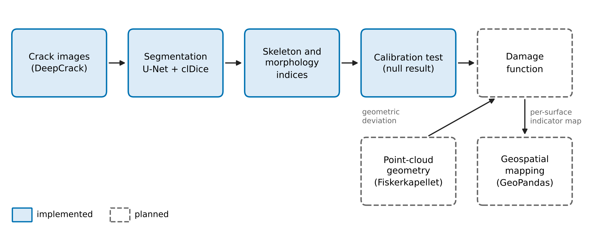
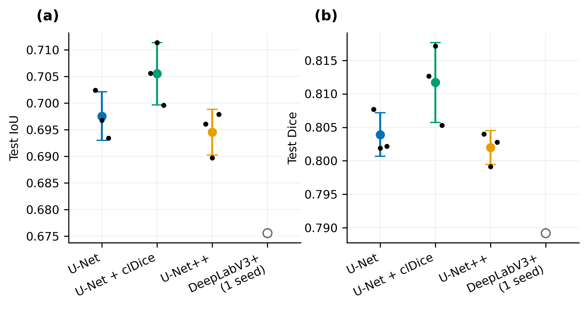
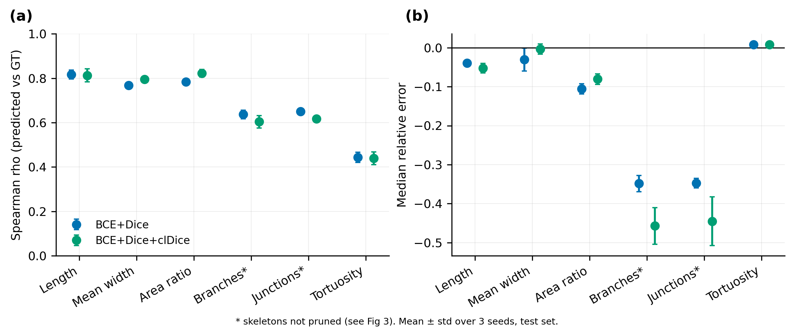
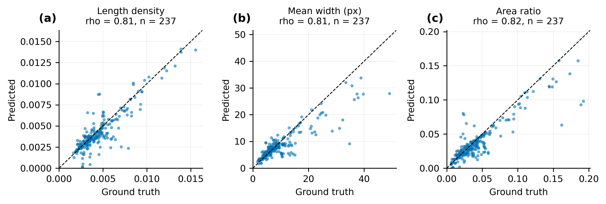
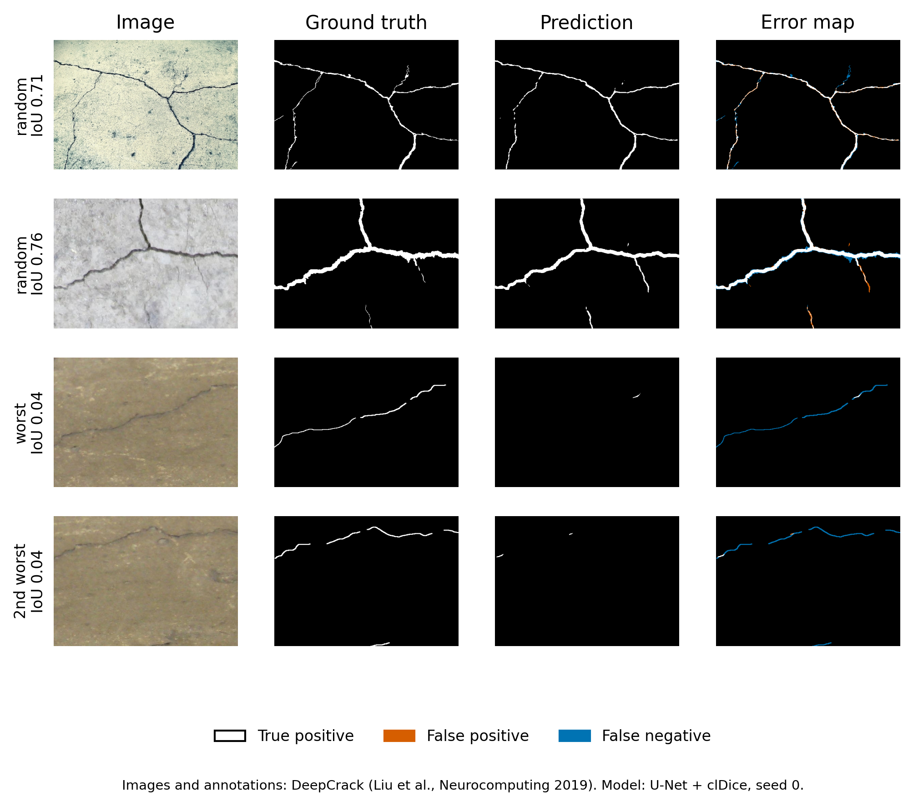
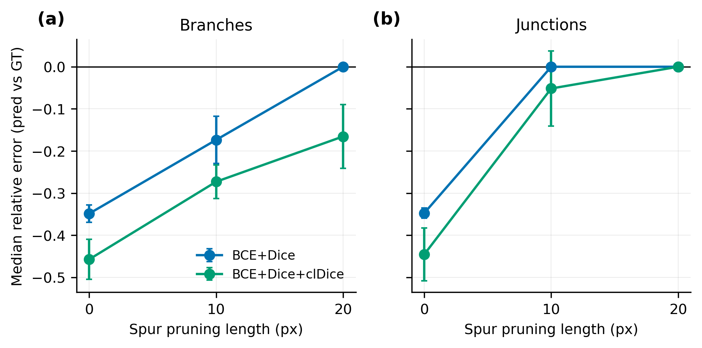
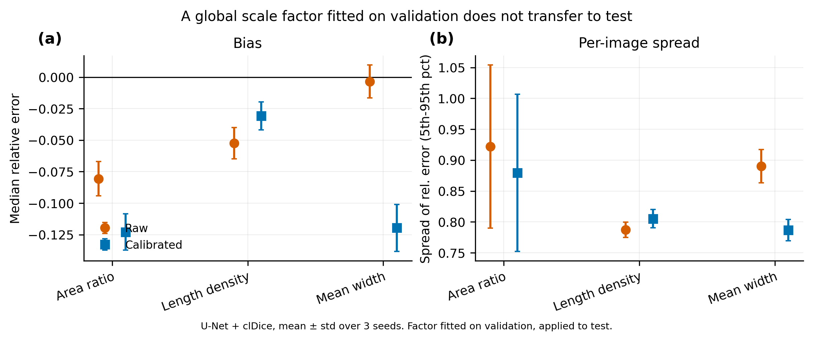

# historic-building-condition-assessment

Crack segmentation and crack morphology indices for building condition assessment. This repository currently holds one finished study, on the DeepCrack dataset. The point-cloud, geospatial and damage-function parts are not started (see Status).

## 1. Question

How reliable are crack morphology indices (length, width, area ratio, branching, tortuosity) when they are computed from predicted segmentation masks instead of ground truth? Segmentation quality alone (IoU, Dice) does not answer this.

*Fig 7. Pipeline overview. Solid boxes are implemented, dashed boxes are planned.*

## 2. Setup

- Data: DeepCrack, 537 images of 544x384 pixels with binary masks.
- Split: official split of 300 train and 237 test images. Validation is 60 images taken randomly from the 300 (seed 0), so training uses 240.
- Model: ResNet34 encoder with ImageNet weights. Architectures: U-Net, U-Net++, DeepLabV3+.
- Training: 40 epochs, AdamW, cosine learning rate, mixed precision, random 384 px crops, flips, brightness jitter.
- Loss: BCE+Dice, or BCE+Dice+clDice (clDice weight 0.5).
- Threshold 0.5. The checkpoint is chosen by validation IoU. The test set is evaluated once per run.
- Seeds 0, 1, 2.
- Indices are in pixels and are computed from skeletons (skimage and skan). The index code was checked on synthetic masks with known values (tests/test_indices.py).

## 3. Results

### 3.1 Segmentation

Test set, mean and standard deviation over 3 seeds.

| Model | IoU | Dice |
|-------|-----|------|
| U-Net | 0.698 +/- 0.005 | 0.804 +/- 0.003 |
| U-Net + clDice | 0.706 +/- 0.006 | 0.812 +/- 0.006 |
| U-Net++ | 0.695 +/- 0.004 | 0.802 +/- 0.003 |
| DeepLabV3+ (1 seed) | 0.676 | 0.789 |

clDice was higher than plain U-Net in all three seeds, by small margins. U-Net++ gave no gain over U-Net. An earlier 30-epoch baseline with a simpler recipe gave test IoU 0.675 and Dice 0.784 (seed 0), so the improved recipe accounts for part of the gain.

*Fig 1. Test IoU and Dice. Bars are mean and standard deviation over 3 seeds, dots are single seeds.*

### 3.2 Index fidelity

Predicted against ground-truth indices on the test set, U-Net variants. Spearman rho and median relative error (bias), mean over 3 seeds.

| Index | rho, BCE+Dice | rho, clDice | Bias, BCE+Dice | Bias, clDice |
|-------|------|------|-------|-------|
| Length | 0.82 | 0.81 | -0.04 | -0.05 |
| Length density | 0.82 | 0.81 | -0.04 | -0.05 |
| Mean width | 0.77 | 0.80 | -0.03 | 0.00 |
| Area ratio | 0.78 | 0.82 | -0.11 | -0.08 |
| Branch count | 0.64 | 0.60 | -0.35 | -0.46 |
| Junction count | 0.65 | 0.62 | -0.35 | -0.45 |
| Tortuosity | 0.44 | 0.44 | 0.01 | 0.01 |

Branch and junction counts here use unpruned skeletons.

*Fig 2. Spearman rho and median relative error per index. Mean and standard deviation over 3 seeds.*

*Fig 5. Per-image ground-truth against predicted indices, U-Net + clDice, seed 0, test set.*

*Fig 6. Two random and the two worst test images, with error maps. Images and annotations are from DeepCrack.*

### 3.3 Spur pruning

Ground-truth skeletons contain many short spurs. The median ground-truth branch count falls from 26.7 (no pruning) to 13.2 (spurs under 10 px removed) to 10.0 (under 20 px).

| Model | Index | Bias, no pruning | Bias, 10 px | Bias, 20 px |
|-------|-------|------|------|------|
| U-Net | Branches | -0.35 | -0.17 | 0.00 |
| U-Net | Junctions | -0.35 | 0.00 | 0.00 |
| U-Net + clDice | Branches | -0.46 | -0.27 | -0.17 |
| U-Net + clDice | Junctions | -0.45 | -0.05 | 0.00 |

Spearman rho stays between about 0.6 and 0.68 at all pruning lengths. Much of the apparent branch undercount comes from spur noise in the ground-truth skeleton. The ranking of branch counts stays moderate. clDice did not improve branch counts.

*Fig 3. Median relative error of branch and junction counts against spur pruning length.*

### 3.4 Calibration (null result)

A single scale factor per index was fitted on validation images and applied to the test set. It did not reduce bias on the test set consistently. Median bias before and after, mean over 3 seeds:

| Model | Index | Bias before | Bias after | Spread before | Spread after |
|-------|-------|------|------|------|------|
| U-Net + clDice | Area ratio | -0.081 | -0.123 | 0.922 | 0.880 |
| U-Net + clDice | Length density | -0.052 | -0.031 | 0.787 | 0.805 |
| U-Net + clDice | Mean width | -0.004 | -0.120 | 0.891 | 0.787 |
| U-Net BCE+Dice | Area ratio | -0.105 | -0.120 | 0.971 | 0.955 |
| U-Net BCE+Dice | Length density | -0.039 | 0.000 | 0.814 | 0.847 |
| U-Net BCE+Dice | Mean width | -0.030 | -0.119 | 0.927 | 0.843 |

Spread is the 5th to 95th percentile range of per-image relative error. It stayed between 0.79 and 0.97, and the change from calibration ranged from -0.10 to +0.03. The factors fitted on validation ranged from about 0.88 to 1.05 across indices and seeds. For area ratio and mean width the factor was below 1 while test bias was already negative, so bias grew in size. For length density the factor was above 1 and bias moved toward zero.

*Fig 4. Bias and per-image spread before and after calibration, U-Net + clDice.*

### 3.5 Overall reading

A good IoU does not guarantee reliable indices. Length density, mean width and area ratio track ground truth reasonably on average. Branch counts, junction counts and tortuosity are weak. Per-image index error is large, so indices should be aggregated over many images or whole surfaces, and their uncertainty carried into any damage indicator.

## 4. What the results do not show

- Only DeepCrack (asphalt and concrete) was used. There is no masonry, timber or heritage data yet and no domain-shift test yet.
- Indices are in pixels, not calibrated to millimetres.
- The validation split is random. DeepCrack file names suggest several crops per source photo, so train and validation may share source images. A grouped-split check has not been run yet and could change the validation-based results, especially calibration. Test numbers are only affected if train and test also share sources. This is an open check, not a finding.
- The validation set is small (60 images), so differences of about 0.01 IoU are within noise.
- No damage function, point-cloud or geospatial result exists yet.
- This is an evaluation study, not a new method.

## 5. Reproducing

1. Download DeepCrack with `datasets/download_deepcrack.sh`, run outside this repository.
2. Run `notebooks/01_crack_segmentation_deepcrack.ipynb` on a Colab T4. After a runtime reset, install segmentation-models-pytorch with `--no-deps` (see the first cell).
3. Regenerate figures 1 to 4 with `python src/figures/make_figures.py`. Figures 5 and 6 need model checkpoints, which are not in the repository, and figure 7 was drawn separately.
4. Run `pytest`.

Reusable code was extracted from the notebook into `src/segmentation` (data, losses, training), `src/morphology/indices.py` and `src/figures/make_figures.py`.

## 6. Status

| Task | Status |
|------|--------|
| Crack segmentation baselines | Done (DeepCrack only) |
| Index fidelity analysis | Done (DeepCrack only) |
| Spur pruning check | Done |
| Global calibration test | Done (null result) |
| Source-grouped split check | Planned |
| Domain shift test on masonry | Planned |
| Damage function | Planned |
| Point-cloud module | Planned |
| Geospatial module | Planned |
| Matlab check | Planned |
| Report | Planned |

## 7. Datasets and licences

DeepCrack is not redistributed here. Its owners restrict use to non-commercial research and education. See [datasets/README.md](datasets/README.md). Fig 6 shows crops from DeepCrack with attribution; see [figures/ATTRIBUTION.md](figures/ATTRIBUTION.md). The code is under the MIT licence; datasets keep their own licences.

## 8. Citation of DeepCrack

Liu et al., DeepCrack, Neurocomputing 2019, doi 10.1016/j.neucom.2019.01.036.
